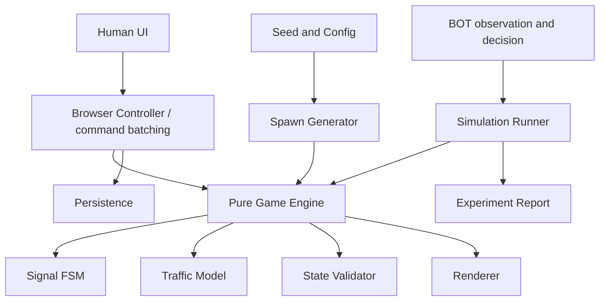

# Game #0006『交差点パニック』基本設計書

- 版: **v1.0-rc3**（未承認）
- 文書ID: TP6-ARCH
- 対応: [01_requirements.md](01_requirements.md)

## 1. アーキテクチャ原則
**Functional Core / Imperative Shell**。ゲームの成否・車両数・信号状態・スコアを決定する権限はPure Game Engineに限定する。DOM/Canvas/localStorage/実時計/`Math.random()`をEngineから呼ばない。描画フレームと100ms固定tickは独立。

## 2. モジュール責務と禁止事項
| ID | 名称 | 唯一の責務 | してはならないこと |
|---|---|---|---|
| M-01 | Game Engine | 1tickの命令評価、信号遷移、通過、到着、終了結果の原子的な組立 | DOM/時刻/保存・乱数使用 |
| M-02 | Signal FSM | 6状態の信号遷移・切替予定tickの計算 | UIイベント直接受付 |
| M-03 | Traffic Model | 待機列の減算・到着・上限超過の判定 | 車両の画面座標更新 |
| M-04 | Spawn Generator | seed・設定から不変な予定生成 | 操作履歴から発生方向を変更 |
| M-05 | Rule Config | 基本ルール版とバランス値の検証 | ゲーム中の設定書換え |
| M-06 | State Validator | Snapshotと発生予定の整合確認 | 不正値を黙って修復 |
| A-01 | Browser Controller | 入力バッチ、実時間蓄積、セッション状態遷移 | ゲーム判定の独自実装 |
| A-02 | Renderer | Snapshotを表示・アニメーション化 | スコア・待機数の権威ある更新 |
| A-03 | Persistence | ベスト記録・設定の安全な保存 | 保存失敗をGRIDLOCK扱いすること |
| A-04 | Simulation Runner | BOT駆動・seed群実験・集計 | Engine内部変数を直接変更 |

論理モジュールは必ずしも「1責務＝1ファイル」を意味しない。過度な汎用化は避ける。

## 3. 正式状態の所有権
`Session`（外殻）がライフサイクルを管理し、`GameSnapshot`（検証済み純粋データ）が交通状態を表す。

| Session.status | Snapshot | result | fault |
|---|---|---|---|
| READY | tick0初期値 | null | null |
| RUNNING | 最新確定tick | null | null |
| PAUSED | 停止時の最新確定tick | null | null |
| FINISHED | 最終確定tick | CLEAR / GRIDLOCK | null |
| ERROR | 最後に検証済みのSnapshot | null | 技術的診断 |

勝敗によるFINISHEDと技術故障によるERRORは同じ意味ではない。異常時に部分更新されたSnapshotはコミットせず、Controllerが最後に検証済みのSnapshotを保全してERRORに移す。

## 4. 入力とイベントの境界
- `START/PAUSE/RESUME/RETRY`は**セッション制御**であり、通常の信号切替tickとは別の操作で処理する。
- `SWITCH_NS/SWITCH_EW`は次の未処理tickへ割り当てる**ゲーム操作**である。
- 同じ処理境界に有効なPAUSEが存在する場合は、信号切替とRESUMEよりPAUSEを優先。信号操作は破棄し、再開後に繰り越さない。
- PAUSEDからのRESUMEを受理した境界でも、同バッチの切替操作は実行しない。次の別境界で入力を受け付ける。
- 経過tickが進まないPAUSED状態を含めて再生するため、ログには単調増加する`boundaryId`と`commandSequence`、`beforeTick`、同境界の入力集合・結果を記録する。ログと実際の発生予定の組で再現性を担保する。
- タブ非表示はControllerにより即時PAUSE。一時停止中は実時間差をゲーム時間へ持ち込まない。

## 5. 時間制御
- Engineは「1回呼ぶと1tick進める」だけ。実時間は参照しない。
- Controllerが単調増加時計を用いてフレーム間隔を蓄積し、100msずつ最大5tickを進める。
- 1回の実時間差が500msを**超えた**場合は蓄積して高速追いつきを行わず自動PAUSE。復帰時も明示的RESUMEが必要。
- 非表示の場合は経過差に関係なくPAUSE。
- 表示中の遅延により`requestAnimationFrame`が止まった場合でも、ユーザーが見ていない間に数秒分のゲームが消化されることを避ける。
- 描画の見た目は補間可能だが、論理座標・通過計数の根拠にはしない。

## 6. BOTと実験の権限分界
- BOT-01〜05は`getObservation`の公開データだけを読む。`SpawnSchedule`やseedは渡さない。
- BOTは人間と同じ信号コマンドを出すだけで、待機数や信号を直接変更しない。
- BOT-06は未来発生予定を使う検証専用の別APIで、MVP必須ではない。
- すべてのBOTに同じ生成済み予定とルール版を使う（同一seedの比較）。
- BOTの成績と、人間が感じる面白さは別ゲートで評価する。

## 7. 記録とバージョン
- 比較時は`ruleVersion`, `balanceConfigId`, `generatorVersion`, `engineVersion`, `botVersion`, `eventSchemaVersion`を識別。
- 同一版で完全一致を求める。異なるバージョン間の一致は自動保証しない。
- 通常ログは操作・重要イベント中心とし、詳細状態ログは必要な検証時だけ保存。個人情報・秘密情報を含めない。
- 最高クリアと最高挑戦記録を分ける。保存失敗時もプレイは継続する。

## 8. 仕様変更の責務
基本ルール、信号順序、tick判定、PRNG、固定オラクル、ERROR契約は承認後にCodexが独自変更しない。変更理由、影響要件ID、影響テストID、既存資産の回帰範囲、人間の承認を必要とする。

**承認区分:** 設計案。実装指示・GitHub操作指示ではない。
